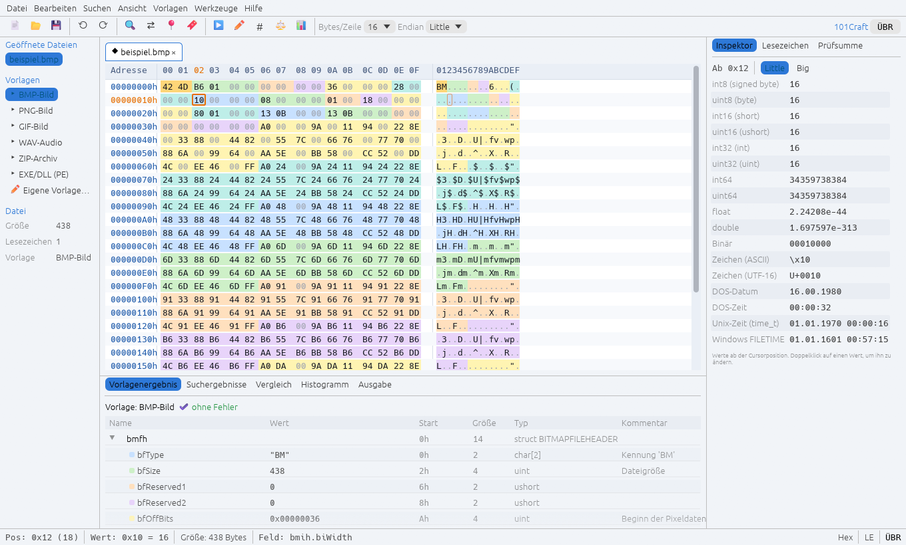
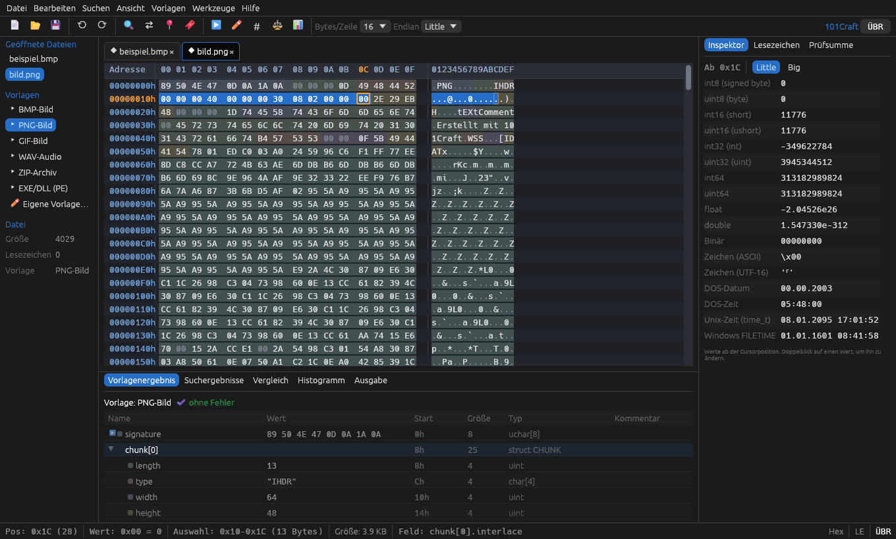
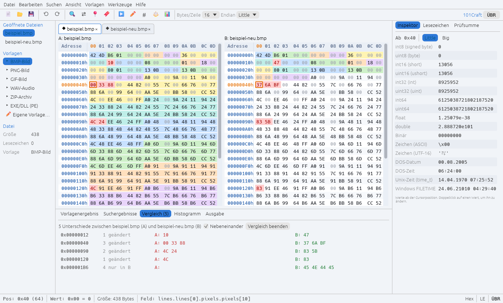
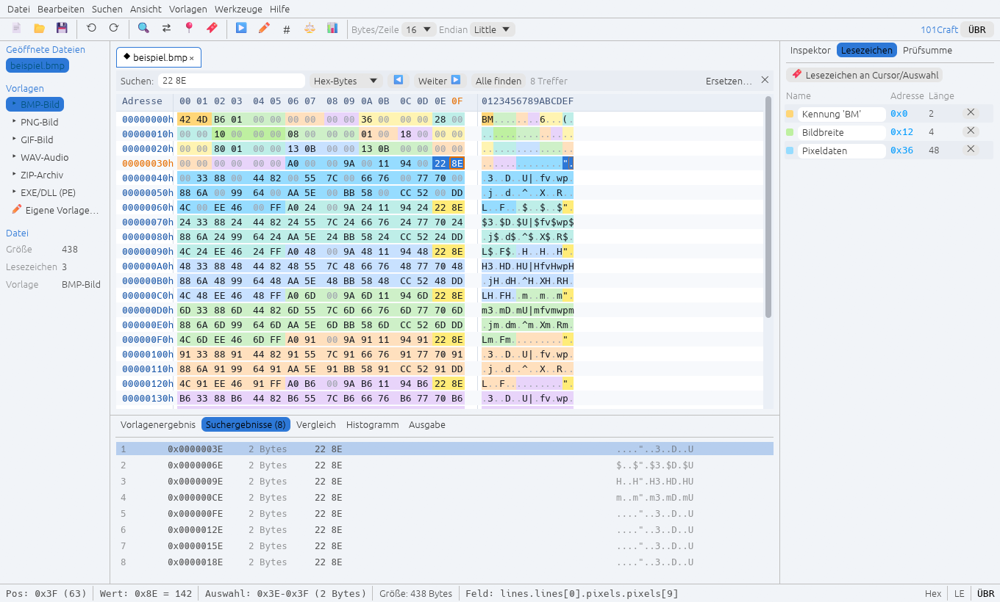
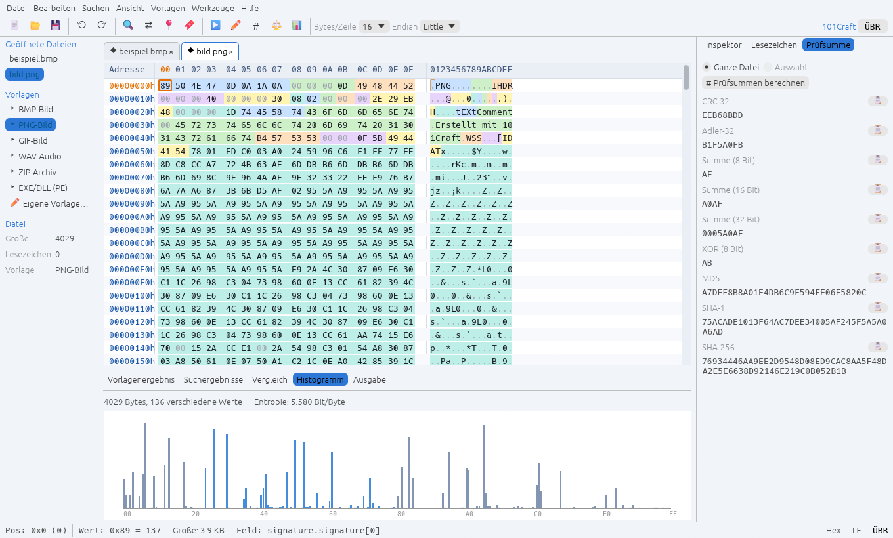
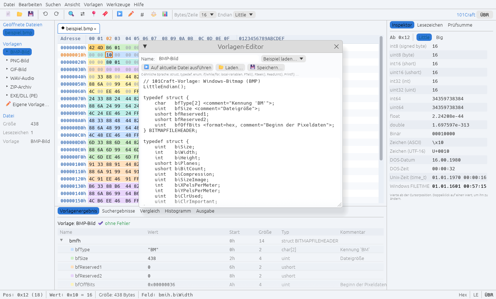

<div align="center">

# 101Craft

**Der schnelle Hex- und Binär-Editor, der Dateien versteht.**

Bytes ansehen, bearbeiten und mit Vorlagen in lesbare Felder zerlegen –
für Windows, Linux und macOS.

[](https://github.com/johmarjac/101Craft/actions/workflows/release.yml)
[](https://github.com/johmarjac/101Craft/releases/latest)




</div>

---

## Warum 101Craft?

Ein normaler Hex-Editor zeigt dir eine Wand aus Zahlen. **101Craft zeigt dir, was sie bedeuten.**
Öffne ein Bild, ein Archiv oder ein Programm – 101Craft erkennt das Format, färbt jedes Feld ein
und listet es mit Namen, Wert und Position auf. Ein Klick auf ein Feld markiert die passenden Bytes,
ein Doppelklick auf den Wert ändert ihn direkt in der Datei.

- ⚡ **Schnell und schlank** – ein einziges Programm, keine Installation nötig (portable Version)
- 🧩 **Vorlagen** zerlegen Dateiformate automatisch in benannte Felder
- 🔍 **Suchen und Ersetzen** nach Text, UTF-16, Hex-Bytes oder Zahlen
- ⚖️ **Dateien vergleichen** – Unterschiede nebeneinander, farbig markiert
- 🧮 **Prüfsummen und Hashes** – CRC-32 bis SHA-256 mit einem Klick
- 🌙 **Hell oder dunkel** – wie es dir gefällt

## Einblicke

<table>
<tr>
<td width="50%">

**Vorlagen im dunklen Design**
Ein PNG-Bild, zerlegt in Signatur, Chunks, Breite, Höhe und Farbtiefe.



</td>
<td width="50%">

**Dateien vergleichen**
Zwei Versionen nebeneinander, jede Abweichung rot markiert und aufgelistet.



</td>
</tr>
<tr>
<td width="50%">

**Suchen und Lesezeichen**
Alle Treffer auf einen Blick, wichtige Stellen mit eigenen Namen merken.



</td>
<td width="50%">

**Histogramm und Prüfsummen**
Byte-Verteilung mit Entropie – erkennt komprimierte oder verschlüsselte Daten sofort.



</td>
</tr>
<tr>
<td colspan="2">

**Eigene Vorlagen schreiben**
Eine einfache, C-ähnliche Sprache – direkt im Programm bearbeiten und sofort ausführen.



</td>
</tr>
</table>

## Download

Fertige Programme gibt es unter **[Releases](https://github.com/johmarjac/101Craft/releases/latest)**:

| System | Datei | Hinweis |
|---|---|---|
| Windows x64 | `…-windows-x64-setup.exe` | Installer mit Startmenü-Eintrag |
| Windows x64 | `…-windows-x64-portable.zip` | Entpacken und starten – ohne Installation, z. B. vom USB-Stick |
| Windows ARM64 | `…-windows-arm64-setup.exe` / `…-portable.zip` | für Snapdragon- und andere ARM-Geräte |
| Linux x64 / ARM64 | `…-linux-x64.tar.gz` / `…-linux-arm64.tar.gz` | entpacken, `./101Craft` starten |
| macOS | `…-macos-universal.dmg` | läuft auf Apple Silicon und Intel |

> **macOS:** Die App ist nicht notarisiert. Beim ersten Start mit Rechtsklick › *Öffnen* bestätigen.

## Alle Funktionen

**Bearbeiten**
- Mehrere Dateien in Tabs, Hex- und Textspalte (Wechsel mit `Tab`)
- Einfüge- und Überschreibmodus, beliebig viele Schritte rückgängig
- Kopieren als Hex, Text oder C-Array; Einfügen von Hex oder Text
- Bytes einfügen, Auswahl mit einem Muster füllen
- Textansicht für UTF-8-Dateien, Drag & Drop zum Öffnen

**Verstehen**
- **Inspektor:** Werte an der Cursorposition als int8 … int64, float, double, binär, ASCII,
  UTF-16, DOS-Datum/-Zeit, Unix-Zeit und Windows-FILETIME – per Doppelklick änderbar
- **Vorlagen** für BMP, PNG, GIF, WAV, ZIP und EXE/DLL, automatisch beim Öffnen erkannt
- Farbige Markierung jedes Feldes, Feldname des aktuellen Bytes in der Statusleiste
- Little- und Big-Endian umschaltbar

**Finden und prüfen**
- Suchen/Ersetzen (Text, UTF-16, Hex, 32-Bit-Zahl), „Alle finden“ mit Trefferliste
- Gehe zu Adresse – hex (`0x1A0`, `1A0h`), dezimal oder relativ (`+16`)
- Lesezeichen mit Namen und Farben
- Prüfsummen: CRC-32, Adler-32, Summe 8/16/32, XOR, MD5, SHA-1, SHA-256
- Dateivergleich nebeneinander mit synchronem Scrollen
- Histogramm mit Entropie-Anzeige

## Vorlagen selbst schreiben

Vorlagen beschreiben ein Dateiformat in einer kleinen, C-ähnlichen Sprache.
101Craft liest die Felder der Reihe nach aus der Datei:

```c
LittleEndian();

typedef struct {
    char   magic[4];               // Kennung
    uint   version;
    uint   count <comment="Anzahl der Einträge">;
} HEADER;

typedef struct {
    ushort id;
    ushort length;
    uchar  data[length];           // Länge kommt aus dem Feld davor
} ENTRY;

HEADER header;
ENTRY  entries[header.count];
```

Unterstützt werden `struct`, `typedef`, `enum`, Arrays mit berechneter Länge, `if`/`while`/`for`,
`local`-Variablen sowie Funktionen wie `FTell()`, `FSeek()`, `FileSize()`, `ReadUInt()` und `Printf()`.
Die mitgelieferten Vorlagen im Ordner [`templates/`](templates) sind gute Beispiele.

## Tastenkürzel

| Taste | Aktion |
|---|---|
| `Strg+O` / `Strg+S` | Öffnen / Speichern |
| `Strg+Z` / `Strg+Y` | Rückgängig / Wiederholen |
| `Strg+C` / `Strg+X` / `Strg+V` | Kopieren / Ausschneiden / Einfügen |
| `Strg+F` / `Strg+H` | Suchen / Ersetzen |
| `F3` / `Umschalt+F3` | Weiter / rückwärts suchen |
| `Strg+G` | Gehe zu Adresse |
| `Strg+B` / `F2` | Lesezeichen setzen / nächstes Lesezeichen |
| `F5` | Vorlage ausführen |
| `Einfg` | Einfügen / Überschreiben |
| `Tab` | Zwischen Hex- und Textspalte wechseln |
| `Strg+Tab` | Nächste Datei |

## Selbst bauen

Voraussetzung ist [Rust](https://rustup.rs).

```sh
git clone https://github.com/johmarjac/101Craft.git
cd 101Craft
cargo run --release -- [Dateien...]
```

Unter Linux werden zusätzlich die Entwicklerpakete für X11/Wayland gebraucht
(z. B. `libxkbcommon-dev libwayland-dev libxcb-render0-dev libxcb-shape0-dev libxcb-xfixes0-dev`).

Hilfreiche Startoptionen:

- `--screenshot bild.png` – startet, zeichnet etwa 120 Bilder, speichert ein Bildschirmfoto und beendet sich
- `--scene NAME` – öffnet eine Demo-Ansicht (`overview`, `dark`, `compare`, `search`, `histogram`, `editor`);
  damit sind die Bilder in dieser README entstanden

## Neue Version veröffentlichen

Der GitHub-Workflow [`Release`](.github/workflows/release.yml) baut alle Plattformen
(Windows x64/ARM64 mit Installer und portabler ZIP, Linux x64/ARM64, macOS Universal)
und legt ein Release mit Prüfsummen an. Dazu genügt ein Versions-Tag:

```sh
git tag v0.1.0
git push origin v0.1.0
```

Über *Actions › Release › Run workflow* lässt sich der Build auch ohne Tag starten –
die Dateien liegen dann als Artefakte am Lauf.
